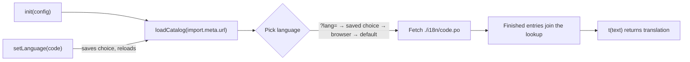

# i18n service

Instructions for adding translations to a page or app with Nodex UI i18n service (`nodexui/i18n`). It is optional and standalone: no framework or component runtime, and it is not part of the main bundles.

- **Audience:** developers adding a language switcher or translating an existing page.
- **Runnable example:** `examples/components/i18n/` (the **i18n** tab of the examples app; open `/examples/index.html#/i18n` from `npm run dev`).
- **Real-world use:** `emvhub/i18n.js` and the `i18n/*.po` folders beside each emvhub module; the examples app does the same in `examples/i18n.js` and `examples/components/*/i18n/` (English and Vietnamese). Update catalogs with `node scripts/emvhub-i18n.mjs extract [--site=emvhub|examples/components] [newLang]`.

## 1. How it works

You write every text in the default language and wrap it in `t()`. Each module keeps its translations in an `i18n/<code>.po` folder next to it and loads them with `loadCatalog(import.meta.url)`. The service picks one language per page load and fills a shared lookup; `t()` returns the translation, or the original text when none exists.



## 2. Install

| How you load it | Use |
| --- | --- |
| ES module | `import { init, t, loadCatalog } from "nodexui/i18n"` (file: `dist/nodexui.i18n.esm.js`) |
| Import map | map `nodexui/i18n` to the ESM file, then `import … from "nodexui/i18n"` |
| Script tag | `dist/nodexui.i18n.min.js` sets `window.thebase.i18n` |

## 3. Quick start

1. Map the module in your HTML:

```html
<script type="importmap">
  { "imports": { "nodexui/i18n": "https://cdn.jsdelivr.net/npm/nodexui@<version>/dist/nodexui.i18n.esm.js" } }
</script>
```

2. Configure once, then load the catalog next to your module:

```js
import { init, t, loadCatalog, languages, currentLanguage, setLanguage, translateHead } from "nodexui/i18n";

init({ languages: [{ code: "en", label: "English" }, { code: "vi", label: "Tiếng Việt" }], storageKey: "my-lang" });
await loadCatalog(import.meta.url); // fetches ./i18n/vi.po when Vietnamese is picked
translateHead();
document.querySelector("h1").textContent = t("Hello {name}", { name: "An" });
```

3. Add `i18n/vi.po` beside the module:

```po
msgid ""
msgstr "Language: vi\n"

msgid "Hello {name}"
msgstr "Xin chào {name}"
```

## 4. API reference

| Function | Purpose |
| --- | --- |
| `init(options)` | Sets languages and defaults. Call once, before the first `loadCatalog()`; it throws afterwards. |
| `loadCatalog(moduleUrl)` | Picks the language on the first call, then fetches `<catalogDir>/<code>.po` next to `moduleUrl` once. Returns a promise; await it before using `t()`. No request is made for the default language. |
| `t(text, params?)` | Returns the translation or the original text; replaces `{name}` placeholders from `params`. |
| `languages()` | The configured `{ code, label }` list, for a switcher. |
| `currentLanguage()` | The code in use, to mark the active switcher item. |
| `setLanguage(code)` | Saves the choice and reloads the page with `?lang=<code>`. |
| `translateHead()` | Translates `document.title` and the meta description. |
| `parsePo(text)` | Parses `.po` text into a `Map` of original text → `{ id, str, fuzzy }` (useful in tooling and tests). |

### `init()` options

| Option | Default | Meaning |
| --- | --- | --- |
| `languages` | `[{ code: "en", label: "English" }]` | Languages the page can show; `code` is the `.po` file name, `label` is shown in the language's own words. |
| `defaultLanguage` | first language | The language your texts are written in; no catalog is loaded for it. |
| `storageKey` | `"thebase-lang"` | `localStorage` key that remembers the visitor's choice. |
| `queryParam` | `"lang"` | URL parameter that forces a language. |
| `catalogDir` | `"i18n"` | Folder beside each module that holds the `.po` files. |
| `headDescription` | `meta[name="description"]` | Selector of the tag `translateHead()` translates. |

Language order: URL parameter, saved choice, browser languages (first two letters), default.

## 5. Writing `.po` files

- One block per text: `msgid` (original, exact match) and `msgstr` (translation). Long texts may continue on following quoted lines.
- Entries with an empty `msgstr` or a `#, fuzzy` flag are ignored, so unfinished work never reaches visitors.
- Text matching is exact and case-sensitive. Changing a source string in code means updating its `msgid`.
- Keep placeholders identical in both: `{name}` in the `msgid` must appear as `{name}` in the `msgstr`.
- Never build a sentence from joined fragments; use one text with placeholders.

## 6. Multi-module apps

Each module loads its own catalog, but language selection and `init()` must happen once and first. Create one local file that every module imports:

```js
// i18n.js
import { init } from "nodexui/i18n";

init({ languages: [{ code: "en", label: "English" }, { code: "vi", label: "Tiếng Việt" }], storageKey: "my-lang" });
export * from "nodexui/i18n";
```

Because ES modules evaluate dependencies first, `init()` runs before any module's top-level `await loadCatalog(import.meta.url)`. A module that shares another folder's texts loads both: `await Promise.all([loadCatalog(import.meta.url), loadCatalog(new URL("../lib/", import.meta.url))])`.

## 7. Gotchas

| Symptom | Cause and fix |
| --- | --- |
| `init() must be called before the first loadCatalog()` | A module loaded a catalog first. Route all imports through the single local file above. |
| Texts stay in English | The `msgid` differs from the code string, the entry is fuzzy or empty, or the `.po` URL 404s (check `catalogDir` and `moduleUrl`). Failed fetches are silent by design. |
| Module-level texts untranslated | `t()` ran before `await loadCatalog(...)` finished. Await it at the top of the module. |
| Switching language reloads the page | By design: every text is redrawn in the new language. |
| Choice not remembered | Storage is blocked; the `?lang=` link still works for that visit. |
| Offline/PWA | Precache each `i18n/<code>.po` in your service worker (see `emvhub/nodexui.pwa.config.js`). |
